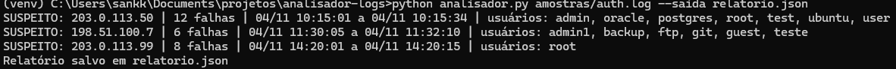

# Analisador de Logs SSH

Ferramenta em Python que analisa logs de autenticação SSH e detecta
ataques de força bruta com base em **quantidade de falhas dentro de uma
janela de tempo**.

Mapeamento MITRE ATT&CK: **T1110 – Brute Force**.

## O problema

Em um SOC, analistas precisam identificar rapidamente IPs que tentam
adivinhar senhas. Contar falhas não basta: 3 falhas ao longo do dia são
normais, 8 falhas em 14 segundos não são. Este projeto detecta o segundo caso.

## Como funciona

1. Lê o `auth.log` linha a linha
2. Extrai IP, usuário e horário das falhas com expressões regulares
3. Agrupa as falhas por IP
4. Marca como suspeito o IP com `--limite` falhas dentro de `--janela` segundos
5. Gera relatório no terminal e, opcionalmente, em CSV ou JSON

## Instalação

```bash
git clone https://github.com/SEU_USUARIO/analisador-logs.git
cd analisador-logs
python -m venv venv
# Windows: venv\Scripts\activate  |  Linux/Mac: source venv/bin/activate
pip install pytest
```

Requer Python 3.8 ou superior. O analisador em si usa só a biblioteca padrão.

## Uso

```bash
python analisador.py amostras/auth.log
python analisador.py amostras/auth.log --limite 5 --janela 120
python analisador.py amostras/auth.log --saida relatorio.json
```

| Parâmetro | Descrição | Padrão |
|---|---|---|
| `log` | caminho do arquivo de log | obrigatório |
| `--limite` | falhas para considerar ataque | 5 |
| `--janela` | janela de tempo em segundos | 120 |
| `--saida` | arquivo de saída (`.csv` ou `.json`) | nenhum |

## Exemplo de saída



## Testes

```bash
python -m pytest -v
```

## Sobre o log de exemplo

`amostras/auth.log` é fictício e usa IPs reservados para documentação
(RFC 5737). Nenhum dado real foi usado.

## Limitações e próximos passos

- Só analisa o formato `auth.log` do OpenSSH
- Assume o ano atual (o formato não traz o ano)
- Ideias: detecção de password spraying, consulta de reputação do IP
  (AbuseIPDB), suporte a logs Apache/Nginx
